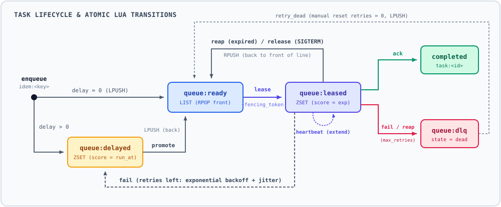

# taskQ

A minimal, hackable task queue built from scratch on Redis and atomic Lua scripts.

Most tutorials build a Redis queue with `LPUSH` and `BRPOP`. That works until a worker crashes mid-task (the task is lost), pauses during a long GC cycle (two workers run the same task), or a client retries after a network timeout (the task is enqueued twice).

`taskQ` implements the machinery required to handle those failure modes cleanly: **leases, heartbeats, fencing tokens, exponential backoff with jitter, delayed scheduling, a dead-letter queue (DLQ), and idempotent enqueue**—all in ~500 lines of readable Python and 9 small Lua scripts.



---

## Quick start

Requires Docker and [uv](https://docs.astral.sh/uv/).

```bash
docker compose up -d                      # start Redis 7.4 (localhost:6379, AOF enabled)
uv sync
uv run python -m taskq.worker             # terminal 1: start a worker
uv run python -m taskq.producer 10        # terminal 2: enqueue 10 tasks
./scripts/dashboard                       # terminal 3: live terminal UI of all queues
```

### Minimal Python usage

You can drive the queue directly in Python via `Broker` (every method wraps a single atomic Lua script):

```python
from taskq.broker import Broker, connect

broker = Broker(connect())  # connects to redis://localhost:6379/0

# 1. Producer: enqueue a task (idempotency_key prevents duplicates on client retry)
broker.enqueue(
    "charge-42",
    payload={"type": "charge", "account": "alice", "amount": 100},
    idempotency_key="order-42",
)

# 2. Worker: lease a task for 10 seconds -> returns (task_id, fencing_token)
leased = broker.lease(worker_id="worker-1", lease_seconds=10)
if leased:
    task_id, token = leased
    payload = broker.payload(task_id)

    # Extend the lease while working, then ack with the fencing token
    broker.heartbeat(task_id, token, lease_seconds=10)
    broker.ack(task_id, token)  # returns False if lease expired and another worker took over
```

---

## Core mental model: Delivery vs. Side effects

| Layer | Guarantee | How it works |
|---|---|---|
| **Queue delivery** | **At-least-once** | Tasks are never silently dropped. Every task eventually reaches `completed` or `dead` (DLQ). |
| **Queue state** | **Fenced** | Every lease increments `fencing_token`. Stale workers cannot `ack`, `fail`, or `heartbeat` a task that was re-leased to someone else. |
| **Downstream effect** | **Exactly-once** *(with idempotency)* | A paused worker might already have written to an external DB *before* losing its lease. `ledger.py` demonstrates why downstream systems need an idempotent `dedupe` key in addition to fencing tokens. |

---

## How the state machine works

Everything lives in **6 Redis keys**:
- `queue:ready` (`LIST`): runnable task IDs. Workers `RPOP` from the right (front of the line).
- `queue:leased` (`ZSET`): currently running task IDs, scored by lease expiration timestamp.
- `queue:delayed` (`ZSET`): scheduled / backing-off task IDs, scored by `run_at` timestamp.
- `queue:dlq` (`LIST`): dead task IDs that exhausted `max_retries`.
- `task:<id>` (`HASH`): task state (`pending` / `delayed` / `running` / `completed` / `dead`), `fencing_token`, `retries`, `payload`, error history, and timestamps.
- `idem:<key>` (`STRING`): maps an idempotency key to its `task_id` (24h TTL).

Every worker runs `promote` (move due tasks from `delayed` -> `ready`) and `reap` (recover expired leases from `leased` -> `ready` or `dlq`) on each loop iteration, so no separate scheduler process is needed.

---

## Design decisions

- **Lease + reap instead of `BRPOP`.** With a plain `BRPOP`, a worker killed mid-task loses that task. Here a task stays in `queue:leased` until it is acked, and a lease that expires sends it back to ready.
- **Heartbeats.** A background thread renews the lease every `LEASE_SECONDS / 3`, so a lease survives two missed heartbeats. Long tasks don't need long leases, and dead workers are detected quickly.
- **Fencing tokens.** Every lease increments `task:<id>.fencing_token`. `ack`, `fail`, `heartbeat` and `release` must present the current token **and** the task must still be in `queue:leased`. A worker that paused past its lease therefore can't complete or fail a task that another worker took over. The token is also passed to the side effect so downstream systems can fence (see `ledger.py`).
- **Lua for every multi-key change.** Redis runs each script atomically, so there are no partial states, such as a task record that exists while its ID is in no queue.
- **Redis server time only.** Every expiry and run time comes from Redis `TIME`, never from a worker's clock, so clock skew between machines doesn't matter.
- **An expired lease counts as a failure.** A task that keeps crashing its worker never gets to call `fail`, but it still ends up in the DLQ instead of looping forever.
- **Queue position.** A reaped or released task already reached the front of the queue once, so it goes back to the front (`RPUSH`). A promoted task only became runnable now, so it goes to the back (`LPUSH`).
- **Backoff.** The base delay is `min(base · 2^(retries−1), cap)`. "Equal jitter" then scales it to between 50% and 100%, so tasks that failed together don't all retry at the same moment. Python generates the random number because `math.random` inside Redis scripts is not reliably random.
- **Idempotent enqueue.** `SET idem:<key> NX EX` makes a producer that retries after a timeout reuse the original task.
- **Graceful shutdown.** The first `SIGTERM` or `SIGINT` stops the worker from leasing new tasks. The task in hand gets `SHUTDOWN_GRACE_SECONDS` to finish and is released if it doesn't. A second signal exits immediately, and the task is reaped later.
- **Redis outages.** The client retries brief blips itself. During a longer outage the worker waits with backoff instead of crashing. `ack`, `fail` and `release` are retried for up to one lease length, because a lost ack means the task runs again.

---

## Where to read the code

If you want to read the implementation from start to finish, follow this order:

1. **`src/taskq/lua/`** — 9 short Lua scripts (`enqueue`, `lease`, `heartbeat`, `ack`, `fail`, `release`, `reap`, `promote`, `retry_dead`). This is the actual state machine.
2. **`src/taskq/broker.py`** — Thin Python wrapper around the Lua scripts and Redis connection retry policy.
3. **`src/taskq/ledger.py`** — SQLite stand-in for an external payment ledger comparing `none`, `fence`, and `dedupe` guards against duplicate execution.
4. **`src/taskq/worker.py`** — The worker loop, background heartbeat thread, and two-stage `SIGTERM` handler.
5. **`src/taskq/producer.py` & `dlq.py`** — CLI helpers for enqueueing tasks and inspecting/retrying the DLQ.

---

## Handy commands for experimenting

```bash
# Simulate slow tasks (15s) with a short lease (5s) and 50% failure rate
WORK_SECONDS=15 LEASE_SECONDS=5 FAIL_RATE=0.5 uv run python -m taskq.worker

# Enqueue 20 tasks that charge $100 to the SQLite ledger with idempotency keys
uv run python -m taskq.producer 20 --charge 100 --idempotency-prefix order

# Inspect the SQLite ledger and check for duplicate charges
uv run python -m taskq.ledger

# Inspect dead tasks in the DLQ and retry them all
uv run python -m taskq.dlq
uv run python -m taskq.dlq retry --all

# Run redis-cli directly inside the container
./scripts/rc LRANGE queue:ready 0 -1
```
